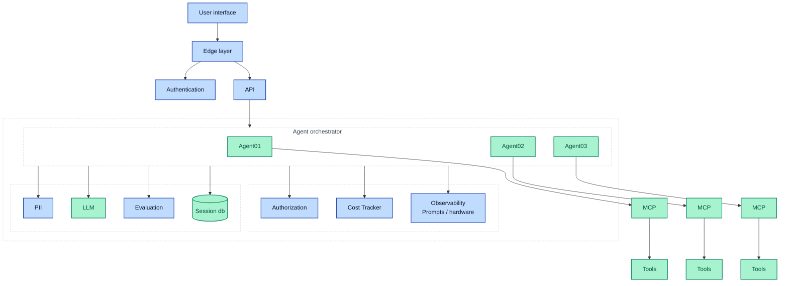

# Chattie

A minimal FastAPI service that fronts an LLM (via OpenRouter + `langchain-openai`) with a Langfuse-instrumented pipeline. Ships with a local Docker Compose stack that can boot a self-hosted Langfuse v3 alongside the app.

## Architecture



### What exists today vs. planned

| Box | Status | Where it lives |
|---|---|---|
| User interface | **Implemented** (Next.js 16 + AI SDK v7 + shadcn/ui, streams from `POST /chat`) | `apps/web/` |
| Edge layer | Planned (reverse proxy / rate limit / WAF) | — |
| Authentication | **Implemented** — email + password via Better Auth in the web app; its JWT plugin signs short-lived EdDSA tokens that the API verifies against `/api/auth/jwks` | `apps/web/lib/auth.ts`, `services/llm/core_llm/auth.py` |
| API | **Implemented** | `services/llm/app.py`, FastAPI |
| Agent orchestrator (Agent01/02/03) | Scaffolded (single LangGraph agent ⇄ tools loop, no multi-agent routing yet) | `services/llm/core_llm/graph.py` |
| MCP + Tools | Partial — local LangChain tools, no API keys needed: `get_current_datetime`, `get_weather` (Open-Meteo), `web_search` (DuckDuckGo via `ddgs`); MCP planned | `services/llm/core_llm/tools/` |
| LLM | **Implemented** (OpenRouter via `langchain-openai`) | `services/llm/core_llm/builder.py` |
| Session db | **Implemented** — the graph is compiled with LangGraph's `AsyncPostgresSaver` (database `chattie` on a Postgres running on the host machine); `session_id` is the `thread_id`, so `/query` is multi-turn per session and history survives restarts. A small `chat_threads` table (title, timestamps) indexes threads for the UI sidebar. | `services/llm/core_llm/builder.py` |
| Observability | **Implemented** (Langfuse client wired in `lifespan`) | `services/llm/app.py`, `services/llm/ops/health.py` |
| Cost Tracker | Partial — Langfuse captures token/cost, no dedicated tracker | via Langfuse |
| Evaluation | Planned (Langfuse Datasets/Scores or local harness) | — |
| PII redaction | Planned | — |
| Authorization | Partial — every API route except `/health` requires a valid token; threads are owned by their user (others get 404). Per-agent / per-tool policy planned | `services/llm/core_llm/threads.py` |

## Layout

```
services/
  llm/                        the FastAPI chat service
    app.py                    entrypoint + lifespan wiring
    config.py                 Pydantic settings (loaded from root .env)
    core_llm/
      builder.py              build_llm / build_memory
      graph.py                LangGraph StateGraph (agent ⇄ tools loop + checkpointer)
      tools/                  LangChain tools exposed to the agent (TOOLS list in __init__.py)
        clock.py              get_current_datetime
        weather.py            get_weather (Open-Meteo)
        search.py             web_search (DuckDuckGo via ddgs)
      prompt.py               greeting prompt template (system + message history)
      routes.py               POST /query (single JSON reply)
      chat.py                 POST /chat (streaming), GET /threads, GET /threads/{id}/messages
      threads.py              chat_threads table: thread titles + timestamps for the sidebar
      ui_stream.py            LangGraph → AI SDK UI message stream (SSE) + history conversion
      tracing.py              shared run config: thread id + Langfuse callback/metadata
    ops/
      health.py               /health probe (LLM + Langfuse)
    Dockerfile                multi-stage, python:3.12-slim
    requirements.txt
apps/
  web/                        Next.js chat UI (port 3001)
    app/chat/[id]/            one page per thread; history loaded on the server
    components/chat/          chat UI components (rendering only, ≤150 lines each)
    components/sidebar/       thread history sidebar + New chat button
    components/ui/            shadcn/ui primitives in use
    hooks/                    React hooks (chat session, prompt input)
    types/                    shared TypeScript types
    lib/                      env validation, API client + chat transport
    proxy.ts                  `/` → `/chat/<new uuid>`
packages/                     placeholder — shared contracts (OpenAPI → TS)
docker-compose.yml            profiles: prod | dev | langfuse
Makefile                      convenience targets
package.json                  npm workspaces root (apps/*, packages/*)
.env                          loaded by docker-compose
```

## Requirements

- Docker Desktop (or Docker Engine) with Compose v2
- Python 3.12 (only if you want to run outside containers)
- Node.js 20+ and npm (for the web UI)
- A `.env` file (see below)

## Configuration

`config.py` reads these from the environment or `./.env`:

| Variable | Purpose |
|---|---|
| `OPENROUTER_API_KEY` | OpenRouter credential used by `langchain-openai` |
| `LLM_BASE_URL` | OpenRouter-compatible base URL (default: `https://openrouter.ai/api/v1`) |
| `LLM_MODEL` | Model identifier (e.g. `openai/gpt-4o-mini`) |
| `LLM_TEMPERATURE` | Float, e.g. `0` |
| `LANGFUSE_PUBLIC_KEY` | Langfuse project public key (`pk-lf-…`) |
| `LANGFUSE_SECRET_KEY` | Langfuse project secret key (`sk-lf-…`) |
| `LANGFUSE_BASE_URL` | Langfuse host URL |
| `DB_HOST` / `DB_PORT` | Host Postgres for chat history (default `localhost` / `5432`) |
| `DOCKER_DB_HOST` | `DB_HOST` to use inside Docker containers (required by Compose; normally `host.docker.internal`) |
| `DB_USER` / `DB_PASSWORD` | Credentials for that Postgres |
| `DB_NAME` | Database for the LangGraph checkpointer (default `chattie`; must already exist) |
| `CORS_ORIGINS` | JSON list of browser origins allowed to call the API, e.g. `["http://localhost:3001"]` |
| `AUTH_JWKS_URL` | Web app's public signing keys, `http://localhost:3001/api/auth/jwks` |
| `DOCKER_AUTH_JWKS_URL` | `AUTH_JWKS_URL` to use inside Docker (normally `http://host.docker.internal:3001/api/auth/jwks`) |
| `AUTH_ISSUER` / `AUTH_AUDIENCE` | Expected JWT `iss` / `aud`: the web app's `BETTER_AUTH_URL` (`http://localhost:3001`) |

The web UI reads `NEXT_PUBLIC_API_URL` (the API base URL, default `http://localhost:8000`) from `apps/web/.env.local`; see `apps/web/.env.example`.

When you run through Compose, `LANGFUSE_BASE_URL` is **overridden to `http://langfuse-web:3000`** so the chattie container can reach the in-network Langfuse service. The value in `.env` only matters when running outside Docker. Likewise, inside containers `DB_HOST` is **replaced by `DOCKER_DB_HOST`** from `.env` (normally `host.docker.internal`) so the container reaches the Postgres on your machine; the other `DB_*` values are used as-is in both modes.

## Running

### Option A — Docker (recommended)

The Makefile wraps the common flows:

```bash
make build       # build the chattie image
make prod        # chattie only, uvicorn (no reload) on :8000
make dev         # chattie only, uvicorn --reload with source bind-mounted
make stack       # chattie (prod) + full Langfuse stack
make dev-stack   # chattie (dev)  + full Langfuse stack
make down        # stop everything (keeps volumes)
make clean       # stop + delete all volumes (destructive)
make logs        # tail logs
make health      # curl /health and pretty-print
make shell       # bash into the running chattie container
```

Under the hood these are just `docker compose --profile <...> up` commands. Three profiles are defined:

- `prod` — `chattie` service, no reload
- `dev`  — `chattie-dev` service, `--reload`, source mounted at `/app`
- `langfuse` — the self-hosted Langfuse v3 stack: `langfuse-web`, `langfuse-worker`, `postgres`, `clickhouse`, `redis`, `minio`

Mix profiles freely:

```bash
docker compose --profile dev --profile langfuse up
```

### Option B — Local Python

```bash
cd services/llm
python3.12 -m venv venv
source venv/bin/activate
pip install -r requirements.txt
uvicorn app:app --reload
```

Both Docker and local runs need the host Postgres from `DB_*` to be running, with the `DB_NAME` database created. The checkpointer creates its own tables on startup. With Homebrew: `brew services start postgresql@15`, then `createdb chattie`.

## Web UI

Ports on this machine: **3000** Langfuse · **3001** web UI · **8000** API · **5432** Postgres · **9090/9091** MinIO.

```bash
make web-install   # once: npm install at the repo root (workspaces)
psql -d chattie -c 'CREATE SCHEMA IF NOT EXISTS auth'   # once
make web-migrate   # once (and after auth upgrades): Better Auth tables
make dev-stack     # terminal 1: API on :8000 + Langfuse on :3000
make web           # terminal 2: UI on http://localhost:3001
make web-lint      # type-check + Biome
```

Sign up at `/sign-up` (email + password). The **first** account also takes ownership of chats created before sign-in existed. The API trusts only tokens signed by the web app, so the web app must be running for the API to accept requests.

Opening `/` starts a new thread at `/chat/<uuid>`; that id is the LangGraph `thread_id` and the Langfuse session, so reloading the page restores the conversation. The browser sends only the newest message to `POST /chat`, which streams back the [AI SDK UI message stream protocol](https://ai-sdk.dev/docs/ai-sdk-ui/stream-protocol) — text deltas plus tool calls/results, rendered as tool cards.

## First boot with Langfuse

The compose file seeds the Langfuse database using `LANGFUSE_INIT_*` variables so the keys in your `.env` work on first run:

- An org/project named **chattie** is created.
- The project public/secret keys are set to whatever is in your `.env`.
- An admin user `admin@langfuse.local` / `ChangeMe123!` is created so you can sign in to the Langfuse UI at <http://localhost:3000>.

After the first successful boot the seeding env vars are idempotent — leaving them in place is fine, but you can also strip them and manage keys through the UI.

## Health check

```bash
curl -s http://localhost:8000/health | python3 -m json.tool
```

Returns `200` when both the LLM `/models` probe and the Langfuse `auth_check` succeed; otherwise `503` with per-service detail.

## Security notes

- `docker-compose.yml` ships with **development-only** values for `SALT`, `ENCRYPTION_KEY`, `NEXTAUTH_SECRET`, Postgres/MinIO/Redis passwords, and the Langfuse admin password. Rotate every one of these before exposing the stack beyond localhost.
- `.env` is in `.gitignore`. If you ever commit it by accident, rotate every key in it — treat anything that touched a repo as leaked.
- Clickhouse/MinIO/Postgres/Redis are not exposed to the host network (only MinIO's console on `:9091`). The only publicly bound ports are `8000` (chattie) and `3000` (Langfuse UI); the web UI dev server adds `3001`.

## Common issues

- **`host.docker.internal` doesn't resolve** — only an issue when running outside the compose network. Inside compose, chattie talks to `langfuse-web` by service name.
- **Langfuse keys don't authenticate** — the seeded project uses the keys from your `.env`. If you changed `.env` after first boot, either reset with `make clean` (nukes volumes) or regenerate keys in the Langfuse UI and sync them back to `.env`.
- **`AttributeError` on `/health`** — if you edited `services/llm/ops/health.py` and introduced lowercase attribute access on `Settings`, remember the fields are uppercase (`settings.LLM_BASE_URL`, not `settings.llm_base_url`).
